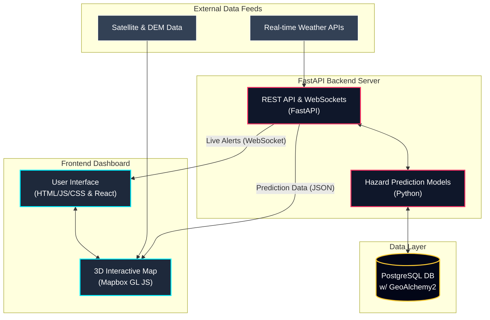

# UrbanPulse - Pune Urban Intelligence Dashboard

UrbanPulse is a real-time, 3D interactive dashboard designed to monitor cascading hazards (like extreme rainfall, floods, and landslides) in the Pune Metro Region. 

## Features
- **Interactive 3D Map**: Built with Mapbox GL JS v3, featuring real-world high-resolution satellite imagery, 3D building extrusions, and accurate topography.
- **Hazard Simulation**: Visualizes the cascading effects of extreme rainfall using real-time data overlays and animations.
- **Backend Integration**: FastAPI backend built to calculate hazard probabilities and stream live alerts via WebSockets.
- **Frontend Framework**: The primary dashboard is built natively in HTML/CSS/JS (`index.html`) for maximum performance, with a secondary React application (`frontend/`).

## System Architecture



## Quick Start (Dashboard)
To view the 3D dashboard:
1. Simply open `index.html` in your browser. 
2. If it does not load properly due to CORS restrictions, serve the directory locally:
   ```bash
   python3 -m http.server 8080
   ```
   Then navigate to `http://localhost:8080/index.html`.

## Backend API
The backend is built with FastAPI and handles live hazard predictions and alert streaming.
```bash
cd backend
python -m venv venv
source venv/bin/activate
pip install -r requirements.txt
uvicorn app.main:app --reload
```

## Technologies Used
- **Mapbox GL JS v3** (Satellite-Streets + 3D Terrain)
- **HTML5 / CSS3 / Vanilla JS**
- **Chart.js**
- **Python / FastAPI** (Backend)
- **React / Vite** (Alternative Frontend)
- **PostgreSQL & GeoAlchemy2** (Database)
