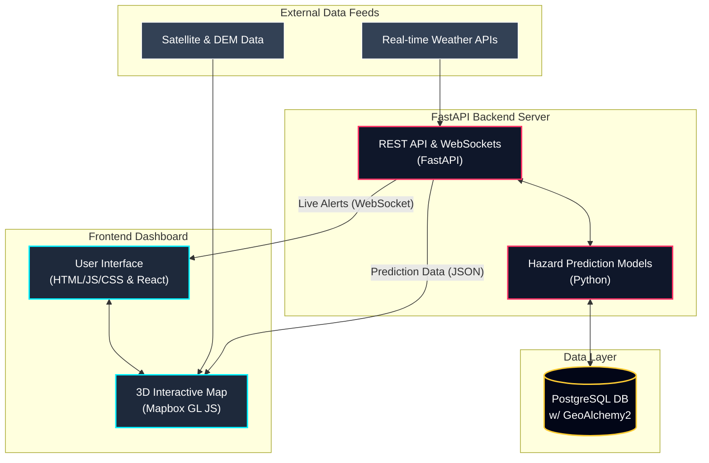

# UrbanPulse - Pune Urban Intelligence Dashboard 🏙️

 

**UrbanPulse** is a next-generation, real-time 3D interactive dashboard designed to monitor and predict cascading urban hazards—such as extreme rainfall, flash floods, and landslides—specifically tailored for the unique topography of the Pune Metro Region.

---

## 🛑 The Problem
Urban areas like Pune are increasingly vulnerable to unpredictable climate events. A severe rainstorm doesn't just cause localized puddles; it triggers a **cascading chain of events**:
1. **Extreme Rainfall** oversaturates the hillsides (like the Sinhagad corridor).
2. Saturated hillsides trigger **Landslides**.
3. Landslide debris blocks rivers or drainage systems.
4. Blocked rivers cause rapid, catastrophic **Urban Flooding** downstream (like the Hadapsar lowlands).

Traditional 2D maps and siloed weather apps fail to visualize this interconnected chain of disasters. Emergency responders need to see *where* the water is flowing, *how* the terrain affects it, and *what* infrastructure is at risk in real-time.

## 💡 Our Solution
UrbanPulse solves this by providing a unified, tactical intelligence platform:
- **True 3D Topography:** We use high-resolution satellite imagery draped over 3D Digital Elevation Models (DEM). You can literally see the hills, valleys, and sharp building extrusions that dictate water flow.
- **Predictive Cascades:** Our backend models calculate the probability of chain-reaction disasters, mapping them directly onto the 3D terrain.
- **Tactical Real-Time Alerts:** Glowing hazard zones, critical infrastructure markers, and live telemetry data (like Khadakwasla Dam levels and Mutha River flow) are streamed via WebSockets.

---

## 🌟 Key Features
- **Interactive 3D Map**: Built with Mapbox GL JS v3, featuring real-world high-resolution satellite imagery, 3D building extrusions, and accurate topography.
- **Hazard Simulation**: Visualizes the cascading effects of extreme rainfall using real-time data overlays and camera-flying animations.
- **Live Telemetry**: WebSocket integration to stream real-time AQI, rainfall metrics, and river levels directly to the UI.
- **Dual Frontend Architecture**: Includes a highly-optimized Vanilla HTML/JS dashboard (`index.html`) for raw WebGL performance, and a modular React application (`frontend/`) for scalable component development.

---

## 🏗️ System Architecture



---

## 🎯 Use Cases
1. **Disaster Management Authorities (NDRF/PMCMC):** To monitor escalating threats during monsoon season and preposition rescue assets before a flood hits.
2. **Urban Planners:** To simulate how new infrastructure projects (like roads or dams) might alter flood plains and landslide risks.
3. **General Public:** To receive real-time, hyper-local alerts about safe evacuation routes.

---

## 🚀 Quick Start Guide

### 1. Running the 3D Dashboard (Frontend)
To view the tactical 3D dashboard:
1. Navigate to the project root.
2. Serve the directory locally (to bypass CORS restrictions for the Mapbox WebGL canvas):
   ```bash
   python3 -m http.server 8080
   ```
3. Open your browser and navigate to `http://localhost:8080/index.html`.

### 2. Running the Backend API
The backend is built with FastAPI and handles live hazard predictions and alert streaming.
```bash
cd backend
python -m venv venv
source venv/bin/activate
pip install -r requirements.txt
uvicorn app.main:app --reload
```
*Note: The backend requires PostgreSQL with PostGIS extensions installed on your system.*

---

## 🛠️ Technologies Used
- **Mapping & WebGL:** Mapbox GL JS v3 (Satellite-Streets + custom 3D Terrain & Fog)
- **Frontend:** HTML5, CSS3, Vanilla JS, Chart.js, React, Vite, Zustand
- **Backend:** Python, FastAPI, WebSockets
- **Database:** PostgreSQL, PostGIS, GeoAlchemy2

---

## 🔮 Future Roadmap
- [ ] Integrate live traffic data to map out dynamic evacuation routes avoiding flooded zones.
- [ ] Add historical replay modes to analyze past disasters (e.g., 2019 Pune Floods).
- [ ] Implement a machine learning model to predict localized waterlogging based on precise DEM flow-accumulation algorithms.

---

## 🤝 How to Contribute
We welcome contributions! Please follow this workflow:
1. Ensure you are on the `main` branch and pull the latest changes (`git pull origin main`).
2. Create a new branch for your feature (`git checkout -b feature/your-feature-name`).
3. Commit your changes with descriptive messages.
4. Push your branch (`git push origin feature/your-feature-name`).
5. Open a **Pull Request** on GitHub for review.
